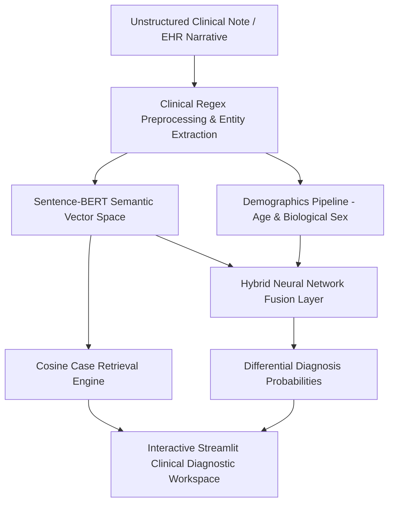

# 🩺 MediMind AI - Clinical Notes Diagnosis Analyzer & Decision Support

[](https://www.python.org/)
[](https://streamlit.io/)
[](https://www.sbert.net/)
[](https://opensource.org/licenses/MIT)

An intelligent clinical decision-support platform that transforms unstructured physician EHR narratives, admission summaries, and triage notes into explainable, evidence-backed differential diagnosis recommendations mapped directly to ICD-10 diagnostic codes.

---

## 🔬 System Overview & Architecture

MediMind AI combines dense contextual semantic embeddings with a hybrid neural network architecture to ingest raw doctor notes and patient demographic variables (Age, Gender) simultaneously:



---

## ✨ Key Features

- **Semantic Case Retrieval:** Computes cosine similarity across thousands of indexed historical patient cases to surface similar clinical presentations.
- **Hybrid Multi-Modal Fusion:** Merges dense note representations with tabular demographic factors for context-aware diagnosis.
- **Automated Entity Parsing:** Intelligently extracts patient age, biological sex, and acute clinical findings without manual tagging.
- **Interactive Streamlit Workspace:** Doctor-friendly web interface featuring preset clinical vignettes (Heart Failure, MI, Pneumonia, Pancreatitis, Diabetic Foot Ulcer), probability bar charts, and ICD-10 mappings.
- **Explainable AI (XAI):** Transparently exposes matched clinical findings and historical reference cases instead of providing black-box outputs.

---

## 📊 Diagnostic Categories Covered

| Category | Primary Presentation | ICD-10 Code |
| :--- | :--- | :--- |
| **Congestive Heart Failure** | Dyspnea on exertion, orthopnea, bilateral edema, elevated BNP | `I50.9` |
| **Acute Myocardial Infarction** | Retrosternal radiating chest pain, diaphoresis, ST elevations | `I21.9` |
| **Community-Acquired Pneumonia** | Productive purulent cough, fever, chills, lobar consolidation | `J18.9` |
| **Chronic Kidney Disease** | Proteinuria, elevated creatinine, electrolyte imbalance | `N18.9` |
| **Asthma Exacerbation** | Severe expiratory wheezing, bronchospasm, reduced peak flow | `J45.901` |
| **Acute Pancreatitis** | Severe epigastric abdominal pain radiating to back, elevated lipase | `K85.9` |
| **Diabetic Foot Ulcer** | Plantar metatarsal neuropathic ulcer, diminished sensation | `E11.621` |
| **Meningitis** | Nuchal rigidity, photophobia, headache, positive Kernig/Brudzinski | `G03.9` |
| **Alzheimer's Disease** | Progressive memory impairment, disorientation, cognitive decline | `G30.9` |
| **Surgical Site Infection** | Incisional erythema, purulent drainage, postoperative fever | `T81.4XXA` |

---

## 🚀 Quickstart & Local Setup

### 1. Clone the repository
```bash
git clone https://github.com/30Piyush2025/Health-Report-Prediction-Model.git
cd Health-Report-Prediction-Model
```

### 2. Install dependencies
```bash
pip install -r requirements.txt
```

### 3. Launch the Interactive Clinical Assistant
```bash
streamlit run app.py
```
Open your browser at `http://localhost:8501`.

---

## 📂 Repository Structure

```text
Health-Report-Prediction-Model/
├── app.py                                  # Streamlit Clinical Assistant Web Application
├── requirements.txt                        # Python dependencies
├── src/
│   ├── preprocessor.py                     # Medical text cleaner & regex entity extractor
│   ├── similarity_matcher.py               # Semantic case matcher & ICD-10 reference base
│   └── hybrid_model.py                     # Multi-modal fusion & probability estimator
├── Health_Report_prediction_model.ipynb    # Research & model exploration notebook
└── README.md                               # Comprehensive documentation
```

---

## ⚠️ Clinical Disclaimer
This system is an investigational decision-support AI designed to augment clinical triage and education. It is not an autonomous diagnostic device and should never replace clinical evaluation by a licensed healthcare professional.

---

## 👤 Author
- **Piyush** - [GitHub Profile](https://github.com/30Piyush2025)
